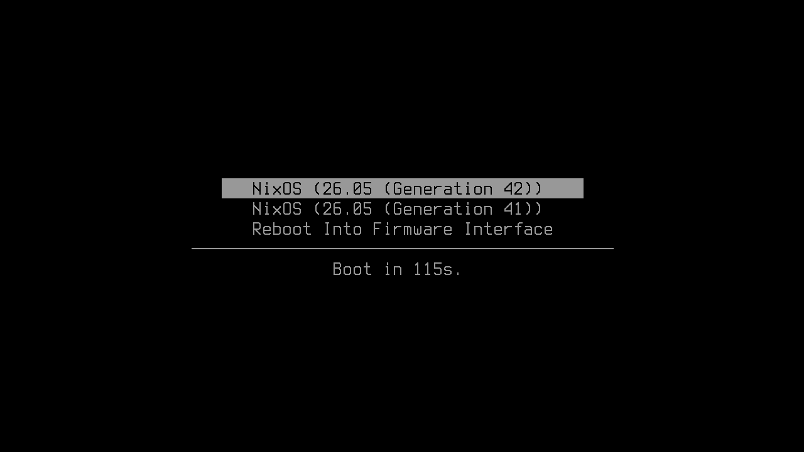
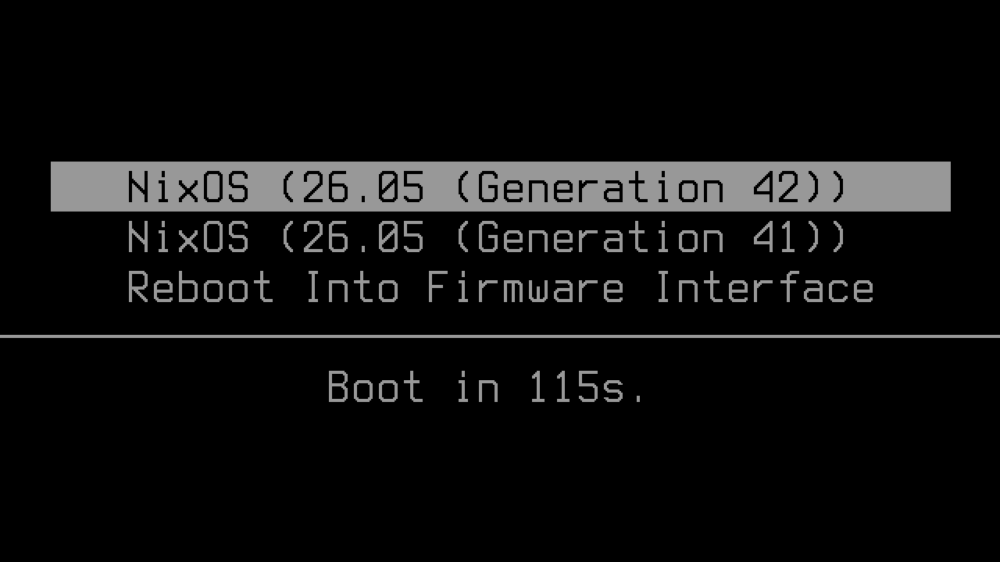
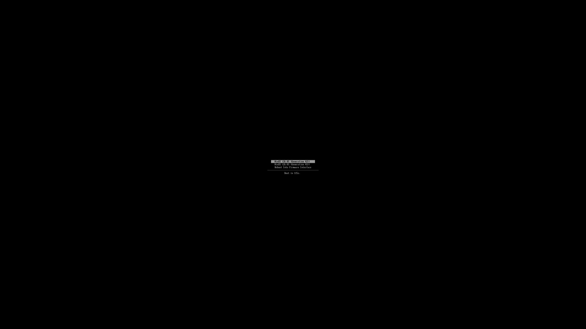
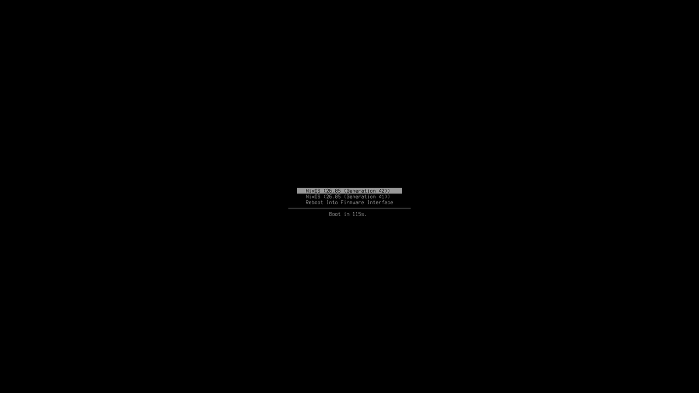
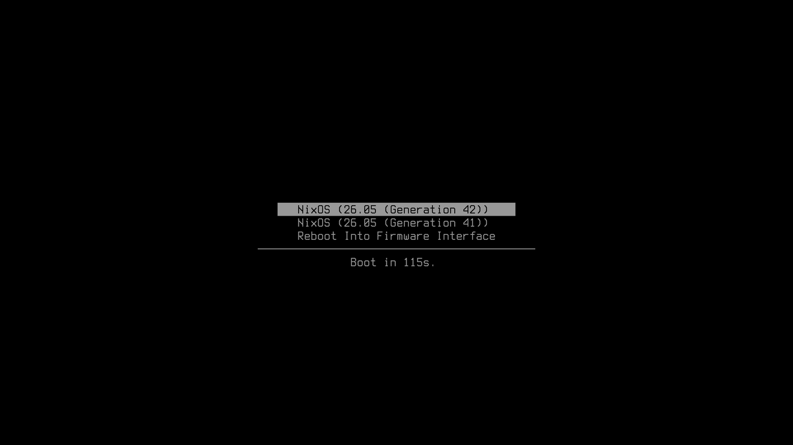

# Big Console

Big Console makes the text of systemd-boot and other UEFI console
applications, such as the UEFI shell, bigger on HiDPI displays without
making it pixelated. It draws a high-resolution font at the panel's
native resolution, so the large text stays as sharp as the panel can
show it.

Big Console is a UEFI DXE driver: a firmware driver that systemd-boot,
the UEFI shell, or the firmware itself loads before the operating system
starts.

Firmware text consoles draw a hardcoded 8×19 pixel font. On a 4K panel
that means unreadably tiny text in every pre-boot surface that uses the
Simple Text Output protocol, most notably the systemd-boot menu. The
usual way to enlarge that text is a low-resolution text mode, which
switches the display to a lower resolution. The panel then scales every
pixel up, so the text gets bigger but also blocky or blurred, and the
display flickers through another resolution switch on the way into the
OS. Big Console replaces the console's renderer instead. The framebuffer
stays at native resolution, and each character is drawn from a font
designed at the larger size, so the glyphs get bigger without getting
coarser.

## Before and after

The systemd-boot menu on a 3840×2160 framebuffer, captured from the
project's VM check. Each image is the same 1280×720 window at 1:1, so the
glyphs compare at their real size.

| Stock console (8×19 cells) | Big Console (16×32 cells) | Big Console 2× (32×64 cells) |
|---|---|---|
|  |  |  |

The whole frame, reduced to a third, shows how much of the panel each
one uses; the stock menu is the speck in the middle.

| Stock console | Big Console | Big Console 2× |
|---|---|---|
|  |  |  |

These come from the `systemd-boot-menu` check, which boots systemd-boot
from an ESP with the driver in its drivers directory, the way it is
deployed, and dumps the framebuffer once the menu is up.

## What it is

A fork of TianoCore edk2's `GraphicsConsoleDxe`
(`MdeModulePkg/Universal/Console/GraphicsConsoleDxe`) with:

- **An embedded high-resolution font.** Glyph bitmaps are generated at build
  time from a PSF2 console font (Terminus 16×32 by default) and drawn
  directly by the driver. Characters the font lacks fall back to the
  platform's HII 8×19 glyphs, stretched to the cell.
- **Integer magnification on top** (`GLYPH_SCALE`), for panels or viewing
  distances where even 16×32 is still too small. A 2× build (32×64 cells) is
  provided. On panels too small for an 80×25 grid of big cells the driver
  degrades to the stock 8×19 rendering path.
- **Console takeover.** The driver binding registers at version `0xFFFFFFF0`
  (the UEFI spec's platform-reserved band, above any IHV-range version a
  firmware console uses — edk2 binds at 0xa, AMI Aptio V at 0x10). At image
  start the driver evicts the incumbent console from every GOP handle,
  re-runs the binding contest it now wins, and re-syncs the system console's
  current mode. Loading the driver is sufficient; no platform modification
  and no explicit reconnect step is required.

The text-mode table keeps the UEFI-mandated 80×25 (and 80×50 where it
fits), the stock driver's historical preset grids, and a computed
full-screen mode — e.g. 240×67 on 3840×2160 with 16×32 cells.

## What it affects

From the moment the driver loads until the operating system takes over
the display, every pre-boot program that writes through the Simple Text
Output protocol renders in the big cells, whatever loaded it and from
wherever. That includes systemd-boot's menu, the UEFI shell, GRUB when
its output terminal is `console` (the usual state of a GRUB fetched
over the network), rEFInd in text mode, iPXE, shim and MokManager, the
firmware's own boot menu and network boot messages, and the few lines
the kernel's EFI stub prints. It does not include programs that draw
their own pixels through the graphics output protocol: GRUB's `gfxterm`
(what distribution configs select by default), rEFInd's graphical mode,
Limine, and Windows Boot Manager. The Linux console after boot is a
different renderer with its own font setting.

How early the driver loads decides how much of that it reaches:

- **Loaded by another UEFI application.** systemd-boot loads drivers
  from `\EFI\systemd\drivers\` on the ESP (the file must end in
  `x64.efi`, or `aa64.efi` on AArch64), rEFInd from its `drivers_x64`
  (or `drivers_aa64`) directory, and the UEFI shell
  on `load`. The effect starts there and covers that program and
  everything it chainloads afterwards.
- **Loaded by the firmware itself.** A `Driver####` boot variable (e.g.
  `Driver0000`, created with `efibootmgr --driver --create ...`) or a
  firmware setup option makes the driver active before the firmware's
  own screens, so the boot menu and network boot messages render big
  too.

Under Secure Boot the driver must be signed with a db-trusted key in
either case; an unsigned driver is skipped and boot proceeds with the
stock console.

The framebuffer stays at native resolution throughout; what a text mode
chooses is the grid. By default the console keeps the firmware's current
mode, normally the spec-mandated 80×25, so the big text sits as a
centered block; selecting the full-screen mode (systemd-boot's
`console-mode max` in `loader.conf`, or `mode 240 67` in the shell at
3840×2160) fills the panel instead. On a firmware whose console also
includes a serial terminal (servers, and edk2's `virt` firmware for
AArch64), the console splitter publishes only the modes every device
supports, so the largest grid is the terminal's 160×42, drawn in the
big cells as a centered block.

## Supported platforms

x86-64 and AArch64 UEFI. On x86-64 the driver is verified on every
change against TianoCore edk2 (OVMF in QEMU at 3840×2160, both variants,
loaded from the UEFI shell) and is in use on one AMI Aptio V firmware,
loaded by systemd-boot. On AArch64 it is verified the same way against
edk2's ArmVirtQemu on an emulated `virt` machine, and has not been run
on real hardware. Firmware early-loading (`Driver####`) has not received
much testing on either. Other vendors' firmware should work by the UEFI
driver-binding rules the console takeover relies on, but has not been
tried.

## Installing

The driver is one `.efi` file. The most common installation puts that
file where systemd-boot looks for drivers. systemd-boot then loads it
every boot before drawing its menu, and everything systemd-boot starts
afterwards, the UEFI shell included, keeps the big font.

### Pick a file

Each [release](https://github.com/clhodapp/big-console/releases) has
four drivers and a `SHA256SUMS` file:

| File | Architecture | Cell size |
|---|---|---|
| `bigconsolex64.efi` | x86-64 | 16×32 |
| `bigconsole2xx64.efi` | x86-64 | 32×64 |
| `bigconsoleaa64.efi` | AArch64 | 16×32 |
| `bigconsole2xaa64.efi` | AArch64 | 32×64 |

Start with the 16×32 build. The 2× build suits a 4K panel viewed from a
distance. Each release file is the store path CI built for the tagged
commit, so it is byte-identical to what `nix build` produces at that
tag.

### systemd-boot on any distribution

Copy the file into `EFI/systemd/drivers/` on the EFI system partition
(ESP), keeping its name. systemd-boot loads only files whose names end
in `x64.efi` (or `aa64.efi` on AArch64), and the release names already
do. With the ESP mounted at `/boot`:

```sh
sha256sum --check --ignore-missing SHA256SUMS
sudo install -D -m0644 bigconsolex64.efi /boot/EFI/systemd/drivers/bigconsolex64.efi
```

Reboot. The menu appears in the big font as a centered 80×25 block. To
fill the screen instead, add this line to `/boot/loader/loader.conf`:

```
console-mode max
```

To uninstall, delete the file from `EFI/systemd/drivers/`.

### NixOS

Add this flake as an input and have systemd-boot install the driver
onto the ESP:

```nix
# flake.nix
inputs.big-console.url = "github:clhodapp/big-console";
```

```nix
# configuration.nix, with `inputs` passed to the module
boot.loader.systemd-boot = {
  extraFiles."EFI/systemd/drivers/bigconsolex64.efi" =
    "${inputs.big-console.packages.x86_64-linux.big-console-dxe}/BigGraphicsConsoleDxe.efi";
  consoleMode = "max";
};
```

The next `nixos-rebuild boot` or `switch` copies the driver onto the ESP.
The other builds are the packages `big-console-dxe-2x`,
`big-console-dxe-aarch64` and `big-console-dxe-2x-aarch64`. All four
are under `packages.x86_64-linux`, because the AArch64 drivers are
cross-compiled, so an AArch64 machine also takes its driver from there
and names the file `bigconsoleaa64.efi`. The [binary cache](#binary-cache)
section lists the caches that let Nix download the driver instead of
building the edk2 toolchain.

### Secure Boot

Under Secure Boot, the firmware loads only drivers signed with a key in
its db. Sign the file the same way you sign systemd-boot itself, for
example with `sbsign` or `sbctl sign`. The firmware skips an unsigned
driver, and boot continues with the stock console.

### Other boot paths

rEFInd loads the same file from its `drivers_x64` (or `drivers_aa64`)
directory, and a UEFI shell started some other way loads it with
`load`. To make the firmware's own boot menu big too, register the
driver as a firmware driver, which runs before any boot manager:

```sh
sudo efibootmgr --driver --create --disk /dev/nvme0n1 --part 1 \
  --loader '\EFI\big-console\bigconsolex64.efi' --label 'Big Console'
```

Copy the file to that path on the ESP first, and change `--disk` and
`--part` to the disk and partition number that hold the ESP. This path
has had less testing than systemd-boot loading.

### Building

`nix build .#big-console-dxe` builds the 16×32 x86-64 driver, and
`.#big-console-dxe-2x` builds the 32×64 one. The AArch64 builds are
`.#big-console-dxe-aarch64` and `.#big-console-dxe-2x-aarch64`, and
they cross-compile from any host. Each output is a directory holding
`BigGraphicsConsoleDxe.efi`.

## Verification

`nix flake check` boots OVMF in QEMU at 3840×2160, loads the driver from a
UEFI shell, and asserts — from the mode table and framebuffer screendumps —
that the console was taken over, the mode grid matches the cell geometry,
and rendered text actually fills the tall cells (with a no-thin-stems check
for magnified builds). Both the 1× and 2× builds are exercised.

In CI the same `nix flake check` runs with the Nix store cached between
runs, since a cold runner builds the edk2 toolchain and both variants
before it can boot OVMF. A pull request that leaves `.github/` alone is
checked by `main`'s copy of the workflow, in `main`'s context once its
own check completes, and adds its build to the shared cache; one that
changes the pipeline is checked by its own copy, under a cache only it
can see. The comments at the top of the two workflow files say why that
split is what makes the cache safe to write from a pull request.

## Binary cache

What `main` builds, both driver variants included, is pushed to the
`clhodapp` cachix cache, signed with its key, so `nix build` at the same
pins downloads the driver instead of building the edk2 toolchain. That
cache skips paths its upstreams already hold, so using it means using
them too:

| Substituter | Public key |
|---|---|
| `https://clhodapp.cachix.org` | `clhodapp.cachix.org-1:EW/0conxH0OQyo0o4ub/grdkFspholmQMSnQyj0vrZI=` |
| `https://nix-community.cachix.org` | `nix-community.cachix.org-1:mB9FSh9qf2dCimDSUo8Zy7bkq5CX+/rkCWyvRCYg3Fs=` |
| `https://numtide.cachix.org` | `numtide.cachix.org-1:2ps1kLBUWjxIneOy1Ik6cQjb41X0iXVXeHigGmycPPE=` |

The flake's `nixConfig` declares all three, so a direct `nix build` or
`nix flake check` here uses them once accepted: answer Nix's prompt, or
pass `--accept-flake-config`. A flake that consumes this one
as an input must add them to its own `extra-substituters` and
`extra-trusted-public-keys`; Nix does not carry an input's settings
into the consumer.

## Licensing

Everything in this repository is BSD-2-Clause-Patent, matching upstream
edk2: the driver sources (`pkg-overlays/default/packages/big-console-dxe/src`, forked
from edk2, per the headers in each file) and the Nix build scaffolding
and tests alike. See `LICENSE` for the terms and `NOTICE` for what came
from where.

The one exception is the font: the glyph bitmaps embedded in the built
driver are generated from Terminus and carry the SIL Open Font License
1.1. See `LICENSES/OFL-1.1.txt`.
